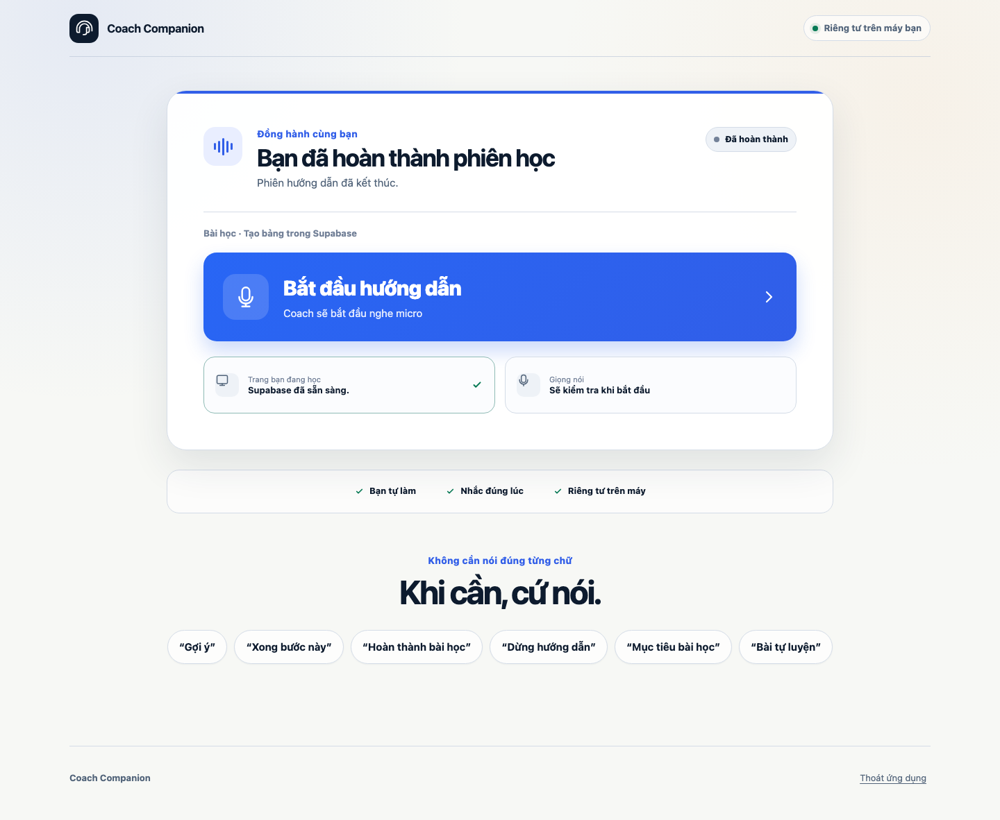
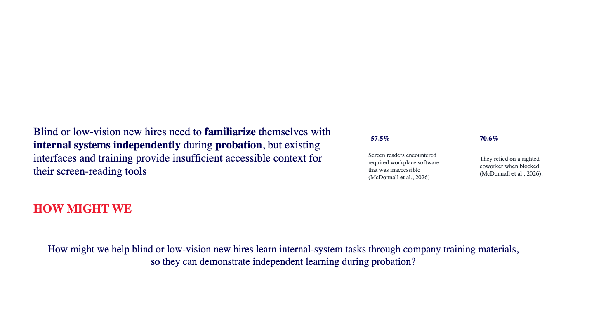
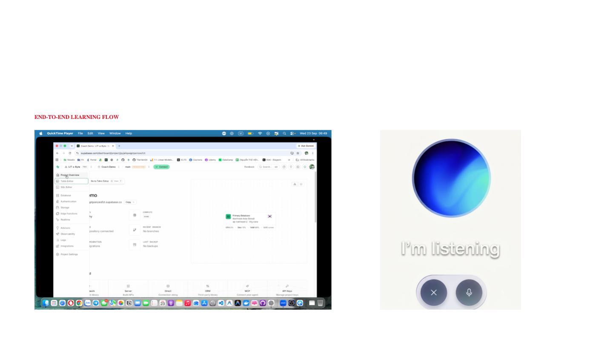
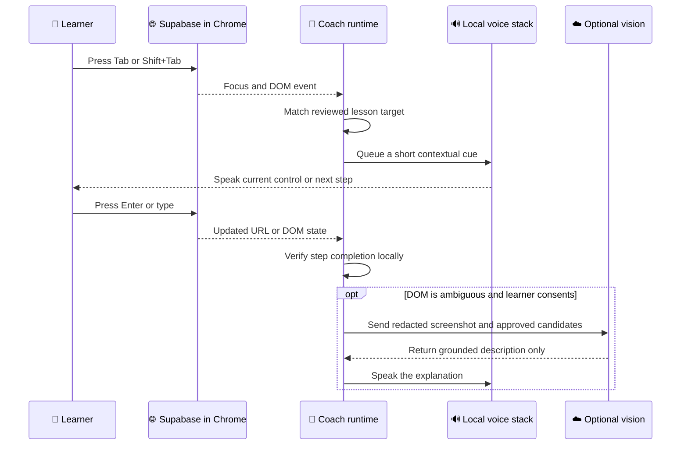
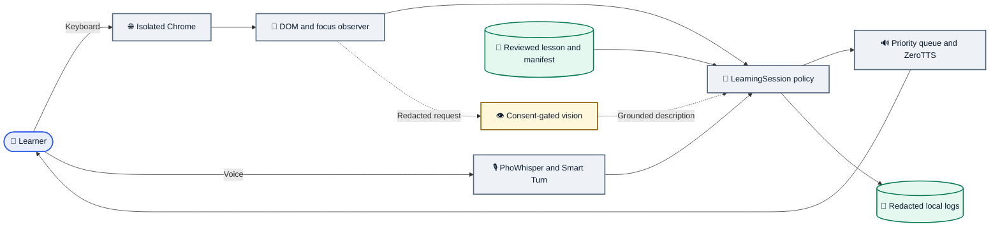

# Coach Companion

**A privacy-first Vietnamese voice coach that helps blind and low-vision learners master unfamiliar web tools—without taking control away from them.**

---


Coach Companion teaches a learner how to complete a real task in Supabase using their own keyboard. It observes focus and page state through the DOM, gives short spoken guidance at the right moment, verifies progress locally, and gradually reduces support as the learner becomes more confident.



*The loopback-only control panel. The learner remains responsible for every meaningful action.*

## Table of contents

- [Why it exists](#why-it-exists)
- [Research and prototype](#research-and-prototype)
- [Product principles](#product-principles)
- [How the experience works](#how-the-experience-works)
- [System architecture](#system-architecture)
- [Privacy and safety](#privacy-and-safety)
- [Quick start](#quick-start)
- [Demo flow](#demo-flow)
- [Testing](#testing)
- [Repository map](#repository-map)
- [Documentation and presentation](#documentation-and-presentation)

## Why it exists

Learning an unfamiliar web application is difficult when important controls are poorly labelled, missing from the keyboard order, or presented without meaningful context. A conventional automation agent may finish the task, but it does not necessarily teach the learner how to do it independently next time.

Coach Companion takes a different position: **the learner acts; the coach observes, explains, and verifies**. Accessibility support remains available throughout the learning lifecycle, while instructional speech moves from orientation to guided practice, independent practice, and finally on-demand help.

## Research and prototype

The pitch deck connects the workplace accessibility problem to the first end-to-end prototype. The repository keeps the presentation alongside the implementation so reviewers can trace the product rationale, interaction model, and test plan.



*Problem framing used to define the onboarding use case. Sources and full context are included in the pitch deck.*



*Early prototype flow connecting a live workplace interface with voice guidance.*

## Product principles

| Principle | Product behaviour |
| --- | --- |
| Learner agency | The learner uses Tab, Shift+Tab, arrow keys, typing, and Enter. The coach does not silently take over. |
| Teach, then fade | Guidance is tracked per skill and becomes less frequent only after verified independent success. |
| DOM before vision | DOM, focus, URL, and reviewed selectors are authoritative. Vision is optional context, never an action engine. |
| Explicit assistance | Focus or synthetic-click help requires a direct spoken request and is written to a local audit log. |
| Verifiable completion | A spoken claim does not complete a step. The reviewed DOM or URL condition must pass, unless the learner gives an explicit confirmation. |
| Quiet by design | Speech is prioritised, deduplicated, and cancelled when stale so the coach does not trail behind keyboard navigation. |

Core capabilities include:

- Vietnamese turn-taking with local PhoWhisper, Smart Turn, and ZeroTTS.
- Native focus tracking with a reviewed, target-only keyboard repair for inaccessible controls.
- Lesson plans grounded in approved PDFs and JSON target manifests.
- Adaptive hints, focus-loop recovery, progress persistence, and learner-controlled support levels.
- Optional, consent-gated vision using redacted in-memory screenshots.
- A macOS launcher and local web control panel—no Terminal is required after setup.

## How the experience works



The current Supabase lesson guides the learner through `Table Editor` → `Create a table` → table name → `Save`. The lesson completes only after the reviewed table route and label appear.

## System architecture



The runtime is deliberately chained instead of fully autonomous. Transcript, lesson policy, browser permissions, and completion checks are evaluated before speech or assistance is allowed.

## Privacy and safety

| Data or capability | Default boundary | Guardrail |
| --- | --- | --- |
| Microphone audio | On device | Used by the local voice pipeline; not sent to OpenAI. |
| DOM and focus data | On device | Raw DOM, cookies, passwords, tokens, and form values are excluded from model payloads and logs. |
| Progress | On device | Stores skill state and verification source, not transcripts or screenshots. |
| Open-ended text answers | Disabled | Requires `COACH_LLM=true`, an API key, and audible session consent. |
| Screenshot vision | Disabled | Requires administrator enablement plus learner consent; sensitive fields are masked and image bytes live for one request only. |
| Browser control | Loopback only | Uses an isolated Chrome profile, exact origin allowlists, and reviewed capabilities. |
| Destructive actions | Learner-only | The coach refuses synthetic activation for destructive lesson steps such as saving a real table. |

Chrome DevTools Protocol is powerful. Use this MVP only with a dedicated staging profile, never with personal or production tabs. See the [security policy](coach/SECURITY.md) before distribution.

## Quick start

### Requirements

- macOS with Google Chrome
- [`uv`](https://docs.astral.sh/uv/) and Python 3.12
- Xcode Command Line Tools for the macOS launcher
- A dedicated Supabase staging project for the real-web lesson

### Install

```bash
git clone https://github.com/TheHien04/RMIT-Project-.git
cd RMIT-Project-
git switch voice-support
cd coach

uv venv .venv312 --python 3.12
uv pip install --python .venv312/bin/python -e ".[dev,voice]"
.venv312/bin/python -m playwright install chromium

cp .env.example .env
chmod 600 .env
```

For the local voice experience, set these values in `coach/.env`:

```dotenv
COACH_MIC=true
COACH_TTS=zerotts
COACH_SPEECH_POLICY=focus
COACH_NAV_MODE=native_focus
COACH_KEYBOARD_REPAIR=target_only
COACH_START_URL=https://supabase.com/dashboard
COACH_TARGET_MANIFEST=fixtures/lessons/supabase-table-editor.json
COACH_LESSON_PDF=fixtures/lessons/supabase-table-editor.pdf
```

Keep `COACH_LLM=false` and `COACH_VISION=false` for a fully local session.

### Build and open the macOS app

```bash
sh scripts/build_macos_app.sh
open "Coach Companion.app"
```

The app starts a loopback-only control panel at `http://127.0.0.1:8787`. For development, run the same panel without building the bundle:

```bash
.venv312/bin/python -m coach app
```

## Demo flow

1. Select **Open Supabase to learn** in Coach Companion.
2. Sign in manually to the dedicated staging profile and open the reviewed project.
3. Return to Coach Companion and select **Start guidance**.
4. Say **“bắt đầu học”** (start learning).
5. Navigate with Tab and Shift+Tab; press Enter yourself when the coach announces the target.
6. Create the `coach_demo_tasks` table while keeping RLS and the default columns.
7. Press Enter on `Save`. The coach verifies the resulting route before completing the lesson.

Useful Vietnamese commands include `gợi ý` (hint), `xong bước này` (finish this step), `mục tiêu bài học` (lesson objective), `bài tự luyện` (practice task), and `dừng hướng dẫn` (stop guidance).

## Testing

Run the deterministic core suite:

```bash
cd coach
.venv312/bin/python -m pytest -q \
  -k "not test_edge_tts_returns_audio and not test_zerotts_streams_audible_audio and not test_phowhisper_transcribes_on_the_gpu and not test_silero_and_smart_turn_score_local_audio"
```

Run browser integration and system smoke tests separately:

```bash
env -u PLAYWRIGHT_BROWSERS_PATH .venv312/bin/python -m pytest -m integration -q
env -u PLAYWRIGHT_BROWSERS_PATH .venv312/bin/python -m pytest -m system -q
```

Hardware/model probes are intentionally separate because they require downloaded models, GPU/audio support, or a live network service. The complete strategy and manual acceptance checklist are in [Testing](coach/docs/TESTING.md).

## Repository map

```text
.
├── coach/
│   ├── app_launcher/          # Native macOS launcher source
│   ├── control_app/           # Accessible loopback control panel
│   ├── demo/                  # Demonstration script
│   ├── docs/                  # Product, navigation, test, and status notes
│   ├── fixtures/
│   │   ├── lessons/           # Reviewed PDFs and target manifests
│   │   └── web/               # Local semantic and role-less test pages
│   ├── sandbox/               # Deliberately inaccessible training fixture
│   ├── scripts/               # App build and isolated Chrome launchers
│   ├── src/coach/             # Voice, browser, policy, privacy, and vision runtime
│   └── tests/                 # Unit, integration, system, and model tests
├── docs/
│   ├── assets/                # README screenshots
│   └── presentation/          # Hackathon pitch deck
└── README.md
```

Generated app bundles, virtual environments, model caches, logs, progress state, local reference repositories, and `.env` files are excluded from Git.

## Documentation and presentation

- [Runtime and operator guide](coach/README.md)
- [Documentation index](coach/docs/README.md)
- [Product principles](coach/docs/PRODUCT_PRINCIPLES.md)
- [Accessible navigation model](coach/docs/ACCESSIBLE_NAVIGATION.md)
- [Implementation status](coach/docs/IMPLEMENTATION_STATUS.md)
- [Test strategy](coach/docs/TESTING.md)
- [Security policy](coach/SECURITY.md)
- [Coach Companion pitch deck](docs/presentation/Coach-Companion-Pitch-Deck.pptx)

## Project status

Coach Companion is a research MVP for Vietnamese-language onboarding on Supabase staging. It is not a replacement for a screen reader, formal accessibility remediation, or human accessibility testing. Before wider distribution, complete blind-user acceptance testing, replace the ad-hoc macOS signature with a Developer ID signature, notarize the app, and resolve the documented dependency exception.

---

_Built by team L!T-a-Byte for the RMIT ADC Hackathon 2026._
