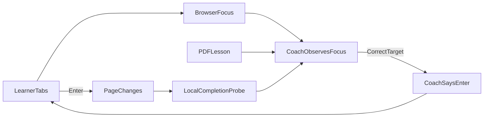

# Điều hướng bàn phím trên web có accessibility layer

Tài liệu này mô tả flow hiện đang có khi coach gắn vào một web thật như
Supabase, nơi button/link/field có accessibility name và nhận focus bằng bàn
phím.

## Mục tiêu

Coach là người hướng dẫn ngồi cạnh người học. Coach **không tự làm bài**:
người học tự Tab, tự Enter và tự hoàn thành thao tác. Coach chỉ:

- đọc bước từ PDF lesson;
- biết control nào đang có focus;
- nói khi người học đã tới đúng control;
- kiểm tra local xem trang đã đổi đúng điều kiện hay chưa;
- giải thích hoặc assist khi người học yêu cầu rõ ràng.

## Trước khi bắt đầu

1. Người học mở Chrome profile riêng cho coach.
2. Người học tự đăng nhập web, MFA/CAPTCHA/consent đều do người học xử lý.
3. Coach chỉ attach đúng một tab đã duyệt qua CDP loopback.
4. Coach kiểm tra origin allowlist. Tab chuyển sang domain khác thì coach dừng
   hướng dẫn thay vì theo tab đó.
5. PDF và manifest phải được review trước. Một label trong manifest bắt buộc
   phải xuất hiện trong citation của PDF; AI không được bịa button/selector.

## Flow học native focus



Ví dụ lesson Supabase hiện tại: mở `Table Editor`.

1. Coach nói: “Nói bắt đầu học”.
2. Người học nói: “bắt đầu học”.
3. Coach đọc module và bước hiện tại, ví dụ: “Bước 1. Mở Table Editor.”
4. Coach nói dùng `Tab` hoặc screen reader để tới control.
5. Người học bấm `Tab`; VoiceOver/NVDA và browser giữ nguyên hành vi bình
   thường.
6. Khi focus tới `Table Editor`, coach nói: “Table Editor. Enter.”
7. Người học tự bấm `Enter`.
8. Coach kiểm tra URL/text/focus theo completion probe local. Với demo Supabase,
   URL phải đổi sang `/dashboard/project/.../editor`.
9. Coach nói hoàn thành một lần, phát hết TTS, rồi tự dừng microphone.

## Những câu có thể nói với coach

| Câu người học nói | Coach làm gì | Có tự thao tác không |
|---|---|---|
| “bắt đầu học” | Đọc module và bước hiện tại | Không |
| “nhắc lại” | Đọc lại instruction của bước | Không |
| “bước này trong tài liệu nói gì?” | Đọc citation và số trang PDF | Không |
| “không hiểu” hoặc câu hỏi mở | Giải thích ngắn theo step/citation hiện tại; có thể dùng LLM nếu bật | Không |
| “focus giúp” | Đặt focus vào đúng control đã bind | Có, chỉ focus |
| “bấm giúp” | Click đúng control đã bind | Có, chỉ sau lời yêu cầu rõ ràng |
| “tôi bấm rồi” | Kiểm tra lại local; không tự nhảy bước nếu probe chưa đúng | Không |

LLM chỉ thấy instruction, target label, citation, context direction và câu nói
của người học. Nó không nhận full DOM, cookie, token, password, API key hay
screenshot mặc định.

## Điều coach đọc được về control

Với accessibility layer, `agent-browser` đọc accessibility snapshot chỉ-đọc,
ví dụ role/name `link: Table Editor`. Local CDP giữ focus, box và completion
probe. Coach dùng thông tin này để:

- giới thiệu **control đang focus**;
- xác nhận control đó có phải target của bước hiện tại hay không;
- nói “Enter” khi label trùng đúng target;
- nói không tìm thấy hoặc ambiguous thay vì đoán.

## Không có “bấm Tab N lần”

Coach hiện **không** nói “bấm Tab 5 lần” và cũng không tự đếm Tab để hứa một
con số cố định. Thứ tự focus thay đổi khi trang re-render, có modal/menu, có
control ẩn, hay thay đổi theo account. Cách ổn định hơn là:

```text
Coach: “Dùng Tab. Mình sẽ báo khi tới Table Editor.”
Người học: Tab
VoiceOver/NVDA + Coach: “Table Editor. Enter.”
Người học: Enter
```

## Không cướp phím mũi tên

Trong `native_focus`, ArrowUp/ArrowDown vẫn thuộc về screen reader để đọc nội
dung trang. Coach không điều khiển VoiceOver/NVDA trực tiếp; coach quan sát
cùng focus semantics mà screen reader dùng.

Pointer cue cũng im trong `native_focus` và `coach_list`, kể cả khi con trỏ
đang đứng tại vị trí cũ sau một lần click vào trang. Người học nói “dùng chuột”
để vào `mouse_cue`; coach chỉ nói hướng sau khi con trỏ thực sự di chuyển.

## Khi trang không có accessibility layer

Plain `div` có click listener nhưng không role/Tab order không phải native
screen-reader-compatible. Khi đó người học mới nói “đi nút” để bật
`coach_list`:

1. Coach phát hiện control visible bằng native tag/role/onclick/CDP listener.
2. ArrowUp/ArrowDown đi qua danh sách coach đã phát hiện.
3. Enter kích hoạt div như một accommodation rõ ràng.
4. Escape hoặc nói “đọc” trả arrows về screen reader.

Đây là fallback cho web lỗi accessibility, không thay thế native focus.

## Những thứ coach không làm

- Không login, nhập password/MFA, đọc cookie/token/API key.
- Không tự bấm button bình thường hay tự hoàn thành bài.
- Không thao tác billing, account/member settings, destructive actions,
  uploads/downloads hay trang nhạy cảm.
- Không bịa target khi PDF hoặc manifest không có bằng chứng.
- Không dùng LLM để quyết định completion hoặc selector.
